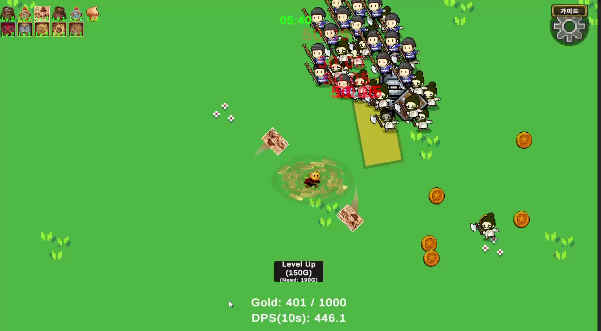

# Coin Survivor — 개발 참여와 QA 사례

상점·인벤토리를 맡아 개발한 팀 프로젝트입니다. 개발 중 고친 버그와 이후 직접 플레이하며 개선한 내용을 정리했습니다.

[STOVE 출시](https://store.onstove.com/ko/games/105249) · [Steam 출시](https://store.steampowered.com/app/5034980/Coin_Survivor/)

## 맡은 일

- **개발:** Unity·C#을 사용한 가방·상점 UI
- **기능 제안과 개발 참여:** 아이템 회전·가방 확장·합성
- **밸런싱 참여:** 구매·확장 비용과 성장 흐름 검토

평소 즐기던 게임에서 참고한 기능을 제안하고 QA 팀원의 피드백을 받아 담당 기능을 고쳤습니다. 구현·코드 분석·밸런스 시트 작성에는 AI 도구를 활용했으며 담당 기능은 직접 실행해 동작을 확인했습니다.

## 대표 이슈: 판매한 무기가 계속 공격하는 문제

2레벨 무기를 팔면 가방에서는 사라지는데 공격은 계속됐습니다. 판매한 무기의 ID·레벨을 무기 제거 처리에 넘기도록 고치는 작업에 참여했습니다.

수정 후에는 가방뿐 아니라 실제 공격도 멈추는지 직접 플레이해 확인했습니다.

- 판매한 2레벨 무기의 공격이 사라짐
- 같은 종류의 1레벨 무기는 그대로 유지
- 판매 확정·취소와 구매·자동 합성·수동 합성도 점검

[이슈 보고서](cases/sold-weapon-keeps-attacking.md) · [당시 확인 기록](playtest/weapon-sale-test-results.md) · [판매 처리 코드](code/weapon-sale.cs)

## 다른 개선 사례

| 사례 | 유형 | 확인하거나 조정한 내용 |
|---|---|---|
| [자석 획득 효과](cases/magnet-pickup-range.md) | 플레이 체감 개선 | 수정 후 실제 획득 범위의 차이 확인 |
| [구매·확장 비용](cases/shop-and-bag-costs.md) | 경제·성장 개선안 | 구매 후 확장할 골드가 부족한 구간의 비용 조정안 |
| [진화 무기의 공격 범위와 분열](cases/evolved-weapon-balance.md) | 전투 조정 | 공격 반경과 분열 단계 제한 |

판매 버그는 2026년 5월 개발 중 확인한 문제입니다. 자석과 진화 무기는 프로젝트 종료 후인 7월에 조정했습니다.

## 자료 보기

- [전체 파일 안내](FILES.md): 파일별 내용과 함께 읽을 자료
- [대표 이슈 보고서](cases/sold-weapon-keeps-attacking.md)
- [수정 후 확인 기록](playtest/weapon-sale-test-results.md)
- [관련 코드 발췌](code/README.md)
- [밸런스 조정안](balance/coin-survivor-balance.xlsx) · [시트 안내](balance/README.md)

## 플레이 화면

2026년 7월 플레이 영상의 일반 전투 장면

이 문서는 기존 [Coin Survivor 공개 저장소](https://github.com/qqyq010/coin-survivor-qa)의 자료를 지원용 통합 저장소에 옮긴 사본입니다. Steam 출시 표기만 현재 제출 자료에 맞췄습니다.
