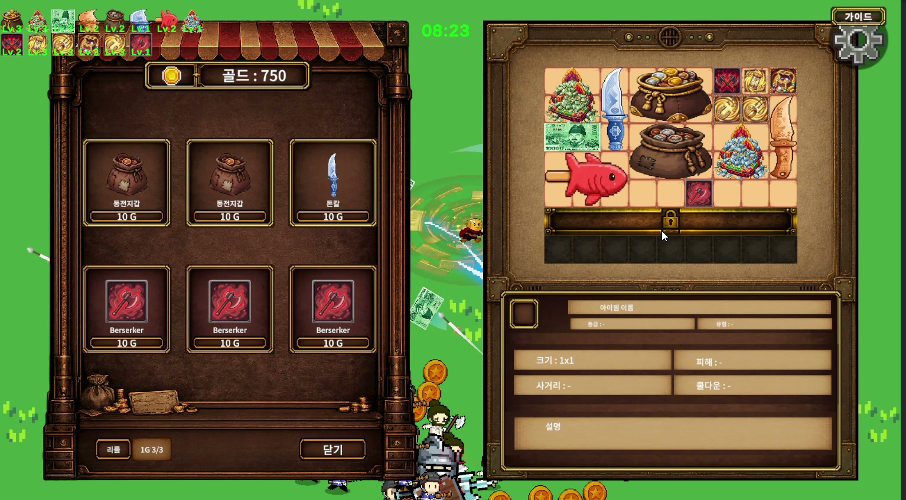

# Coin Survivor 상점과 인벤토리 개발 참여

아이템을 사고 가방에 배치하며 전투를 이어 가는 생존 게임입니다. 골드는 상점 이용뿐 아니라 생존에도 필요한 자원입니다.

저는 상점과 인벤토리를 맡아 팀 개발에 참여했습니다. 구매와 아이템 배치 및 관리 기능을 담당했고, 수정 후 동작을 직접 확인했습니다. Coin Survivor는 STOVE에 출시됐습니다.

[STOVE 상점](https://store.onstove.com/ko/games/105249)

[Steam 상점](https://store.steampowered.com/app/5034980/Coin_Survivor/)

## 직접 확인한 두 사례

| 사례 | 제가 한 일 |
| --- | --- |
| [무기는 팔렸는데 공격은 나가는 버그](cases/sold-weapon-keeps-attacking.md) | 수정 후 판매한 무기의 공격 중단과 남겨 둔 무기의 유지를 함께 확인했습니다. |
| [구매와 가방 확장 비용](cases/shop-and-bag-costs.md) | 초반 진행에서 느낀 부담을 AI에 분석하도록 요청하고 조정 후 다시 플레이했습니다. |

## 관련 자료

[구매와 합성을 포함한 조건별 확인 결과](checks/test-results.md)

[개발 중 전투 화면](checks/combat.jpg)

[비용 조정표와 밸런스 시트](balance/README.md)

[판매와 상점 진입 코드](code/README.md)

[회의록과 작업 기록 정리](../work-records/README.md)

[처음으로](../README.md)
