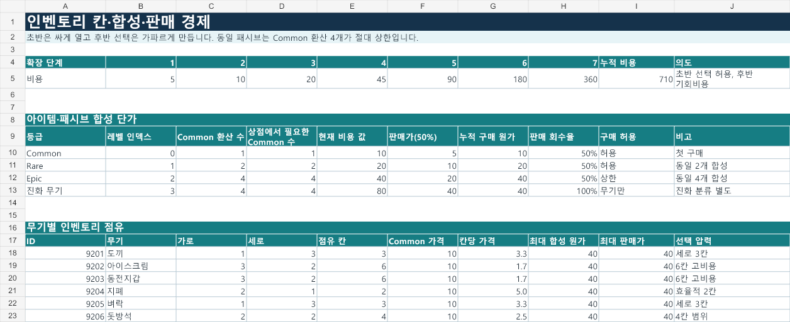

# 아이템을 사고 나면 가방을 늘릴 돈이 부족했습니다

## 직접 플레이하며 느낀 부담

초반 특정 구간에서 진행이 막히는 느낌을 받았습니다. 골드를 생존에도 쓰는 게임이라 아이템 구매와 가방 확장 비용이 겹치는 부담이 더 크게 느껴졌습니다.

AI에 영상과 코드 수치를 검토하고 비용 조정표를 작성해 달라고 요청했습니다. 당시 분석에는 114G로 10G 상품 네 개를 구매하는 예가 있었습니다.

| 항목 | 골드 |
| --- | --- |
| 구매 전 보유 골드 | 114G |
| 상품 네 개의 구매 비용 | 40G |
| 구매 후 잔액 | 74G |
| 첫 가방 확장 비용 | 100G |
| 부족한 골드 | 26G |

## AI가 작성한 조정안 검토

상품 구매와 가방 확장에 드는 비용을 함께 비교했습니다. 아래는 AI가 작성한 인벤토리 확장 비용 조정표입니다.

이후 비용 변경이 진행됐고, 저는 다시 플레이하며 상점과 거래 구간이 전보다 수월해졌다고 느꼈습니다. 재플레이한 정확한 조정 버전은 확인하지 못했습니다.

[밸런스 시트 설명](../balance/README.md)

[Excel 파일](../balance/balance.xlsx)

[상점 진입 코드](../code/shop-entry-costs.cs)

[Coin Survivor 소개](../README.md)
