# 게임 플레이 기록

Football Manager와 문명 5 같은 전략 게임을 즐겼고 World of Warcraft와 던전앤파이터는 오래 플레이했습니다. 캐릭터 육성과 전투, 캠페인과 덱 구성, 대전 게임의 플레이 기록을 함께 정리했습니다.

| 게임 | 플레이 시간과 달성 기록 |
| --- | --- |
| Football Manager 2023 | 420.7시간과 월드컵 우승 |
| 문명 5 | 58.6시간과 모든 승리 조건 달성 |
| World of Warcraft | 확인한 캐릭터 합계 2,158시간과 정예 타락자 느조스 |
| 던전앤파이터 | 모험단 43레벨과 59캐릭터, 컬렉션 46퍼센트 |
| 붕괴 스타레일 | 활동 308일과 업적 1,091개, 개방 캐릭터 50개 |
| PUBG | 124.8시간의 과거 플레이 기록 |
| 스타크래프트 2 | 캠페인과 노바 임무 완료 |
| Slay the Spire | 94.9시간과 아이언클래드 클리어 |

## 게임별 화면

Football Manager 2023 기록

문명 5 기록

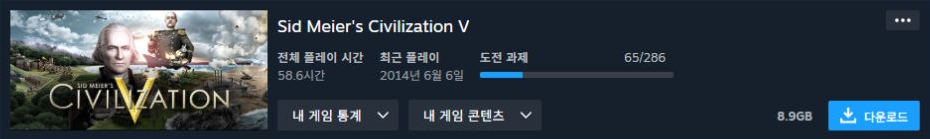
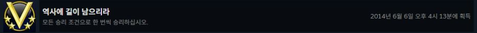

World of Warcraft 기록

AccountPlayed에서 확인한 캐릭터의 플레이 시간 합계입니다. 계정 전체의 누적 플레이 타임은 아닙니다.

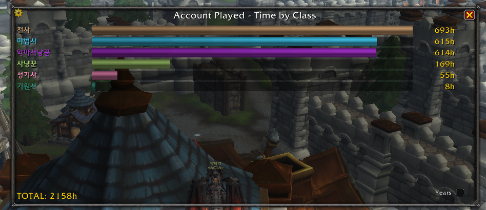
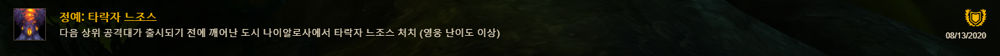

던전앤파이터 기록

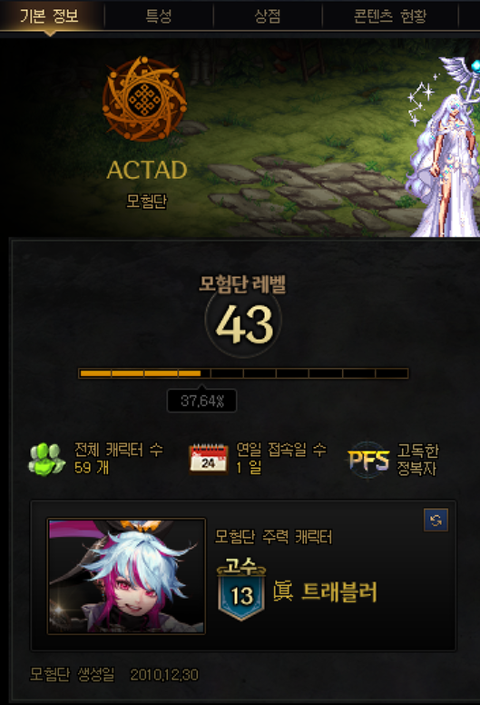
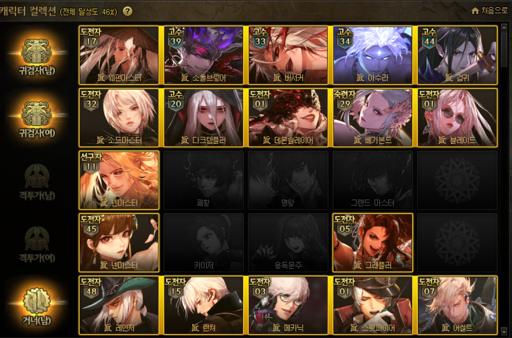

붕괴 스타레일 기록

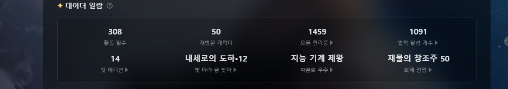

보유한 캐릭터와 장비로 조합을 비교하고 싶었던 경험은 [Star Rail Lab 제작](../star-rail-lab/README.md)으로 이어졌습니다.

PUBG 기록

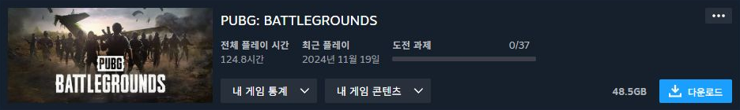

스타크래프트 2 기록

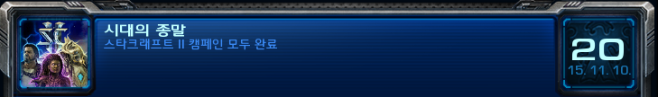
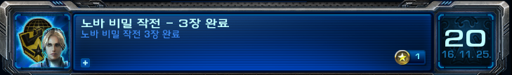

Slay the Spire 기록

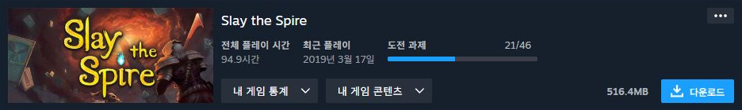
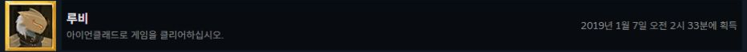

[처음으로](../README.md)
