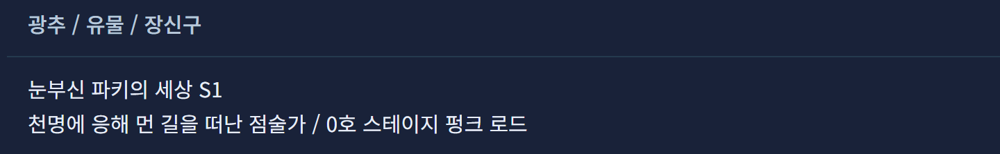
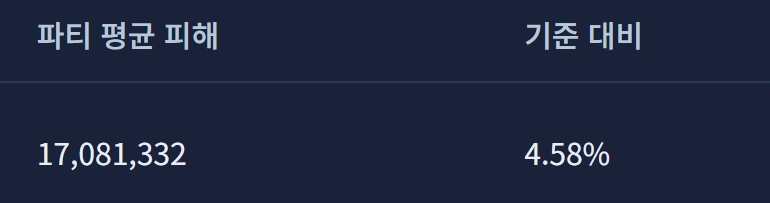

# Star Rail Lab 제작

## 내 캐릭터와 장비로 조합을 비교하고 싶어서

스타레일에는 좋은 도구가 많았지만 제 데이터를 연결하기 어렵거나 반영이 느리게 느껴졌습니다. 보유한 캐릭터와 장비인 광추, 유물을 토대로 어떤 조합을 쓰고 어디에 육성을 집중할지 비교하고 싶었습니다.

만들고 싶었던 기능은 보유 자원에 맞는 4인 조합 비교와 12인 콘텐츠에 쓸 세 팀 구성이었습니다. 조합에 따라 필요한 유물과 장비 배분도 함께 비교하려고 했습니다.

## 제가 맡은 일

필요한 기능을 정하고 앱의 실행 결과를 살폈습니다. 결과가 목적과 다르면 요구를 다시 정리해 전달했습니다. 코드 작성과 수정, 자동 검사는 Codex가 맡았습니다.

스캐너가 계속 실패해 임의의 조합부터 만들도록 했습니다. 하지만 추천된 조합은 제가 플레이하며 알고 있던 게임 환경에 맞지 않았고, 제 보유 상태도 반영하지 못했습니다.

공식 사이트와 DB 링크, 문제 화면과 스캔 중단 로그를 전달했습니다. 보유 자원과 콘텐츠 조건을 반영해야 한다는 요구를 다시 설명했습니다.

[당시 화면과 제가 전달한 피드백](feedback.md)

## 현재 확인할 수 있는 결과

현재는 지정한 파티에서 다른 세 명을 고정하고 한 캐릭터의 장비 후보를 바꿔 계산하는 단계입니다. 아래 수치는 실제 게임 측정값이 아닌 모델 계산입니다.

화면에 표시된 이 후보의 파티 평균 피해는 17,081,332이고 기준 대비 차이는 4.58퍼센트입니다.

## 아직 남은 목표

계정 데이터 연동과 보유 자원으로 세 팀을 구성하는 기능은 구현하지 못했습니다. 실제 게임 결과와의 대조도 남아 있습니다.

[AI가 작성한 입력 변경과 결과 처리 코드](code/README.md)

[처음으로](../README.md)
