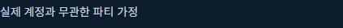
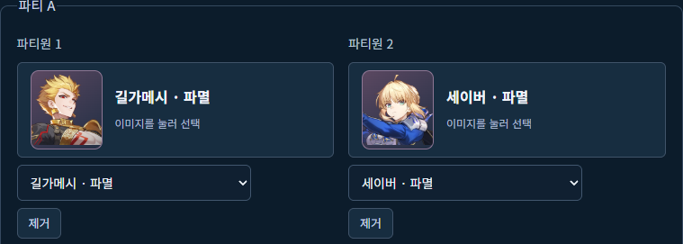

# Star Rail Lab 실행 결과와 피드백

## 원했던 기능과 달랐던 화면

당시 앱은 실제 보유한 캐릭터와 장비를 연결하지 않은 파티를 가정해 비교하고 있었습니다.

[당시 비교 전체 화면](screens/previous-comparison.png)

제가 원한 것은 보유 자원과 콘텐츠 조건을 반영한 비교였습니다. 추천된 조합도 제가 알고 있던 게임 환경에 맞지 않는다고 판단했습니다. 공식 사이트와 DB 링크, 문제 화면과 스캔 중단 로그를 전달하며 원하는 기능을 다시 설명했습니다.

## 현재의 입력과 계산

파티와 캐릭터 수치, 전투 조건을 지정해 계산합니다. 현재 장비 후보 비교는 다른 세 명을 고정한 상태에서 한 캐릭터의 장비를 바꾸는 방식입니다.

[파티와 전투 조건 입력 화면](screens/party-input.png)

[행동 횟수와 누적 피해 계산 화면](screens/damage-summary.png)

[장비 후보 비교 전체 화면](screens/equipment-comparison.png)

이 화면의 값은 입력 조건에 따른 모델 계산입니다. 실제 게임 측정값으로 확인한 결과는 아닙니다.

## AI가 구현한 결과 처리

입력 조건을 바꾸면 이전 계산 결과를 지우고 뒤늦게 도착한 과거 응답을 사용하지 않는 처리도 있습니다. 구현과 자동 검사는 AI가 수행했습니다.

[동작 설명과 코드](cases/input-and-result-validation.md)

[제작 목적과 제가 맡은 일](README.md)
