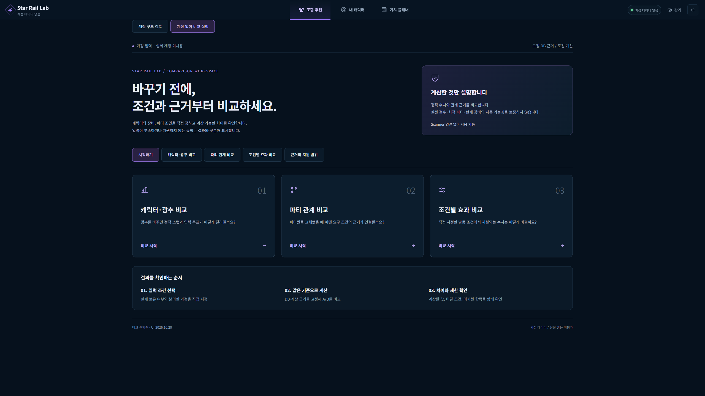
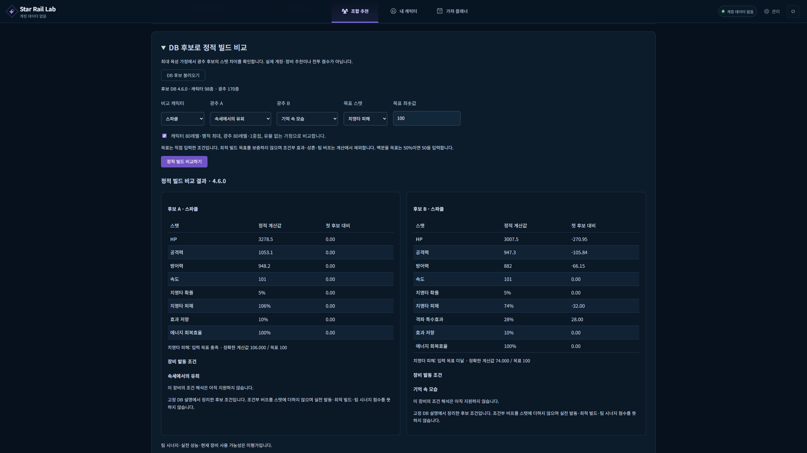
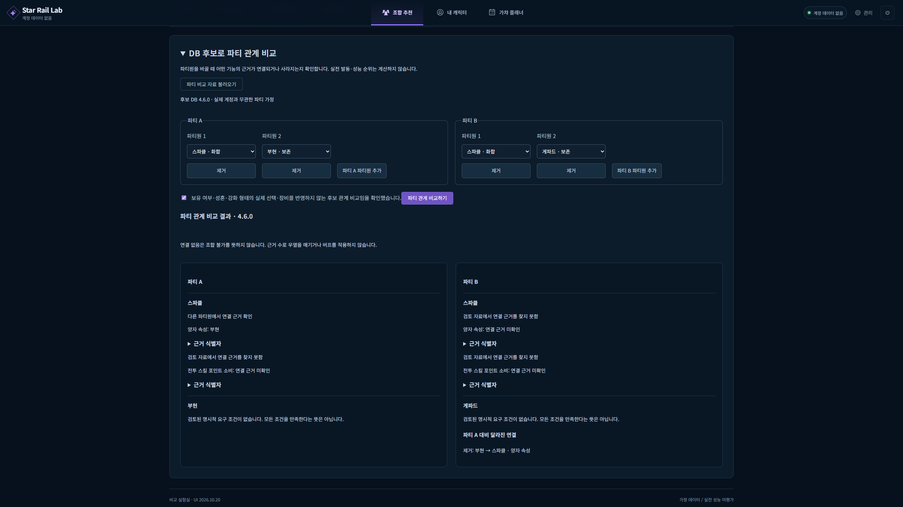
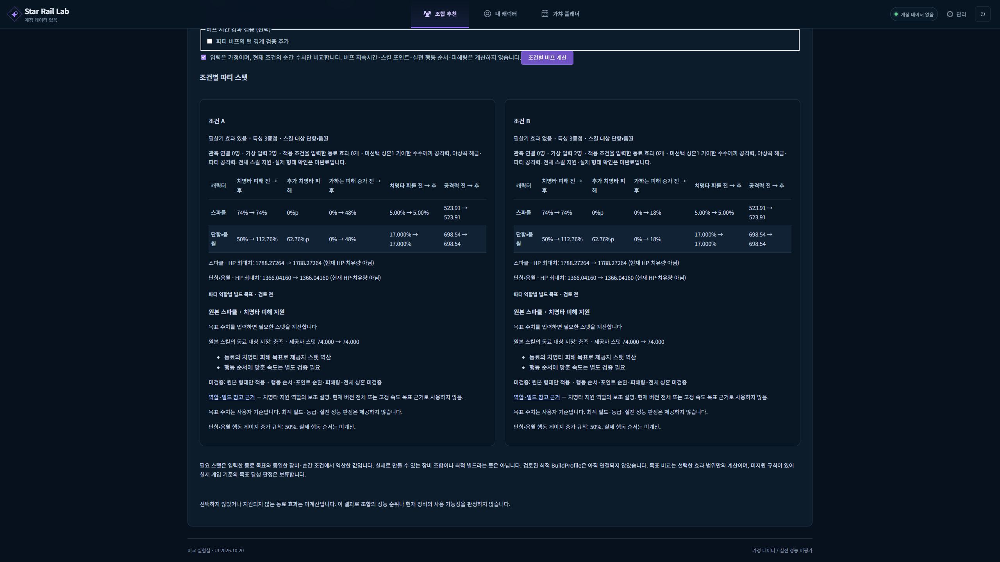
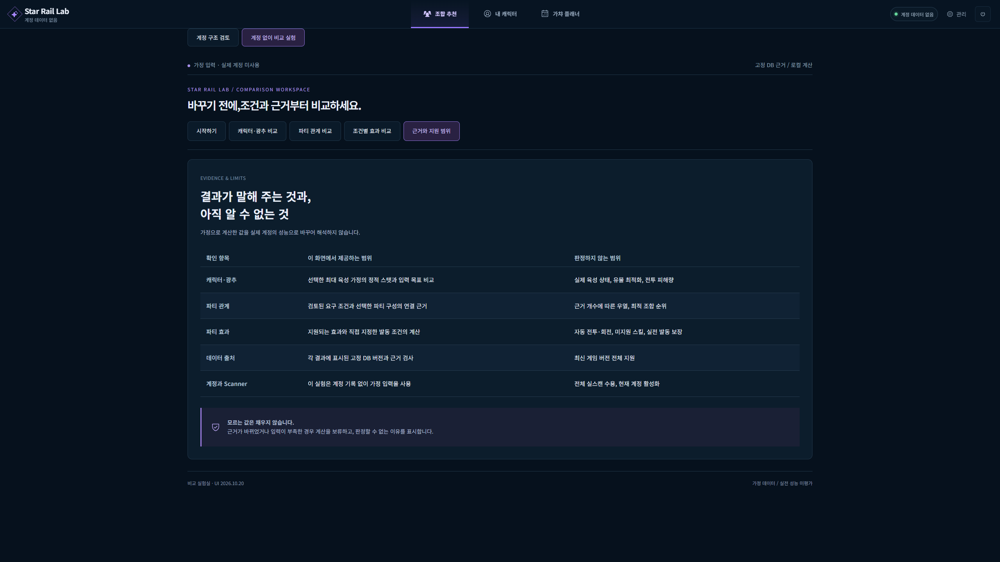

# 실제 앱 화면과 사용 흐름

2026년 10월 20일 같은 로컬 앱에서 촬영한 2560 x 1440 PNG 5장입니다.
실제 계정 대신 직접 지정한 가정 입력을 사용했습니다. 계산은 React UI에서 기존 FastAPI로 요청한 결과입니다.
각 이미지를 클릭하면 원래 해상도로 볼 수 있습니다.

## 1. 사용 목적 선택

캐릭터와 광추, 파티 관계, 조건별 효과 중 비교 목적을 고릅니다.
입력 조건을 정한 다음 같은 기준으로 계산하고 차이와 제한을 확인하는 순서를 안내합니다.

## 2. 캐릭터와 광추 비교

같은 최대 육성 가정에서 광추 A와 B만 바꿉니다.
화면의 예시는 스파클 80레벨과 행적 최대, 유물 없음이며 광추는 모두 80레벨과 1중첩입니다.
치명타 피해는 A 106퍼센트와 B 74퍼센트로 표시되고 직접 입력한 목표 100퍼센트의 충족 여부를 함께 확인합니다.
장비의 발동 조건 해석이 미지원인 경우 해당 상태를 결과 아래에 표시합니다.
실제 계정의 현재 육성과 최대 육성을 비교하거나 최적 장비를 판정한 결과는 아닙니다.

## 3. 파티원 변경과 근거 연결

A는 스파클과 부현, B는 스파클과 게파드의 2인 가정입니다.
부현을 바꾸면 양자 속성에 관한 연결이 제거되는 이유를 표시합니다.
연결 근거가 없다는 결과는 조합 불가나 성능 열세를 뜻하지 않습니다.

## 4. 발동 조건의 차이

스파클 원본과 단항 음월 2인 가정에서 스킬과 필살기, 특성을 10레벨로 두고 특성 3중첩과 스킬 대상 음월을 직접 지정했습니다.
A는 필살기 효과 있음, B는 없음입니다. 가하는 피해 증가가 48퍼센트와 18퍼센트로 달라집니다.
선택한 효과의 순간 수치 비교이며 실제 피해량과 행동 순서, 자동 전투 결과를 계산한 화면은 아닙니다.

## 5. 결과의 근거와 제한

정적 수치와 파티 관계, 지원 효과의 계산 범위를 보여 줍니다.
데이터 출처와 함께 실제 계정 수집과 장비 최적화, 실전 성능 등의 남은 범위를 안내합니다.

[화면별 가정과 해시](evidence/captions.json) / [실행 확인 범위](verification.md) / [프로젝트 소개로](README.md)
